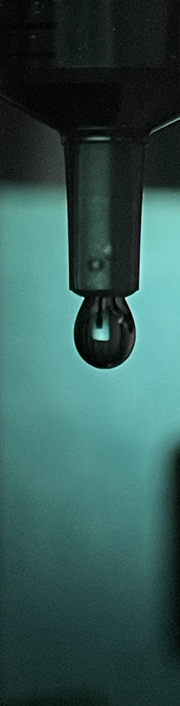

# Pendant-Drop Surface Tension Estimation

## Experimental Image

This photograph is the input to the OpenCV contour detection notebook. The extracted contour is used to estimate the liquid's surface tension.

## Files

- `droplet_contour_detection.ipynb`: extracts a contour from `1.jpg` and saves `curve_data.npy`.
- `pendant_drop.ipynb`: numerical simulation, training and experimental parameter inference.
- `layers.py`: neural network layers and training-related implementations.
- `utils.py`: contour processing and sampling utilities.
- `1.jpg` and `curve_data.npy`: the supplied sample image and contour.

## Setup and Execution

Install dependencies with `pip install -r requirements.txt`, then launch `jupyter notebook` from this directory.

1. Run the contour detection notebook cell by cell and inspect the left/right boundary points. Some contour selection steps require manual adjustment.
2. Open the pendant-drop notebook, run numerical simulation to generate `rawData.pkl`, and then execute the training sections in order.
3. Inference requires `plCPU.pt` and `R0CPU.pt`. These trained weights are not included; train the models first or supply compatible weights.

## Current Limitations

The original code uses explicit `.cuda()` calls. Full training therefore requires a CUDA-capable NVIDIA GPU and a matching PyTorch environment. The example includes a 5,000-epoch training configuration; runtime depends on hardware.

The notebook retains experimental constants, including needle diameter `d=2.2` and the density-gravity factor `9980`. Check calibration, units and density difference before applying the code to another liquid or apparatus. The implemented conversion is `sigma = 9980 * (R0 * 1e-3)**2 / beta`, giving N/m under the stated unit convention.

The modules and notebooks contain repeated class definitions and experimental sections. Later definitions override earlier ones when cells run sequentially. Repository preparation translated comments and explanatory text and cleared historical outputs; it did not verify full training, weight-loading compatibility or end-to-end measurement accuracy.
